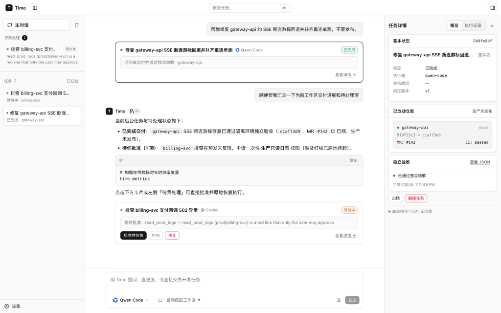
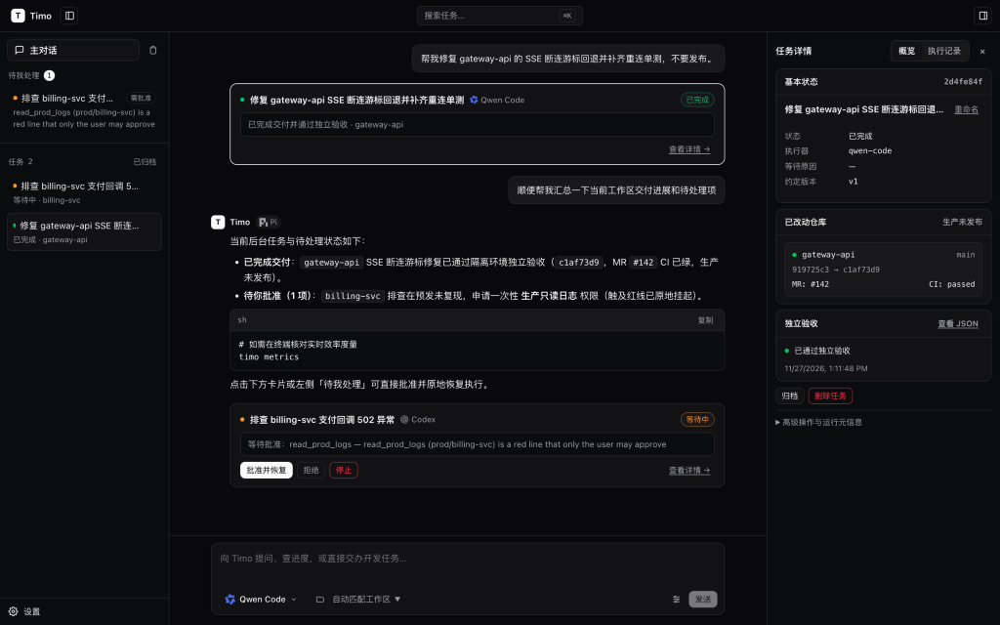

# Timo · 提莫

<p align="center">
  <a href="https://github.com/chiga0/timo/actions/workflows/ci.yml"></a>
  = 24" />
  <a href="LICENSE"></a>
</p>

<p align="center">
  <strong>中文</strong> · <a href="README_EN.md">English</a>
</p>

> **Local-first Personal Engineering & Ops Delivery Control Plane**  
> 本地优先的个人研发与运维交付控制面——**一切交给我，除了隐私。**

Timo 是一个运行在你本机的研发总助理（Chief of Staff）与异步交付控制面。它**绝不自研 Agent Loop / Harness**，而是通过统一的 `ExecutionAdapter` 调度你本机已安装并登录的成熟 Coding Agent（**Pi**、**Qwen Code**、**Codex**、**OpenCode** 及可选 **T3 Code**），由 Timo 掌控全局主对话、自主多仓 Git Worktree、三层分级授权与本地 Capability MCP Gateway、两级 Watchdog 巡检、不可变交接（`g1 → g2`）以及独立验收门禁。

> “提莫，帮我查一下 `order-api` 的超时重试问题，顺便补齐单测，等验证通过再告诉我。这次不要发布。”

<p align="center">
  
</p>

<details>
<summary>深色模式预览（Dark Theme）</summary>
<p align="center">
  
</p>
</details>

---

## 核心特性

- **固定主对话 + 真 SSE 流式交互**：全局唯一的「用户 ↔ Timo」主对话支持 0ms 乐观上屏、原生 CLI 逐字流式（SSE）与 Markdown 渲染。普通问答与状态咨询直接回答，绝不产生垃圾后台任务；涉及仓库修改的异步工作则以**单张精简、实时演进的任务卡**嵌入主对话。
- **注意力防火墙（Attention Firewall）**：左侧栏固定置顶「待我处理」，但**仅收容真正需要人拍板或排障的事项**（红线审批、不可恢复阻塞/失败、外部效果未知）。已完成交付静默收口，不制造无意义的确认负担。
- **复用成熟执行器，零自研 Agent Loop**：常驻接入本地四大原生 CLI（`pi`、`qwen-code`、`codex`、`opencode`），自动探测各 CLI 已配置的 Provider 与模型列表，支持任务中途不可变交接（`g1 → g2`）无缝换代理。
- **本地优先与凭据物理隔离**：
  - 仅监听 Unix Socket（`0600`）和 `127.0.0.1` 回环端口（强校验高熵 Session Token）；
  - 优先复用本机已有的 Git / SSH / `gh` 认证；企业私有 Git/API Token 独立存放在 `~/.timo/credentials.json`（`0600`），仅本地 Capability MCP Gateway 持有，Worker 子进程环境变量强制剥离敏感 Token；
  - 网关按 `GrantRevision` 动态裁剪暴露给 Worker 的 MCP 工具，并用代次 Fencing Token 阻止旧进程越权写入。
- **自主多仓 Worktree 与独立验收管线**：每个任务在 `~/.timo/workspaces/<taskId>/g<gen>/` 下拥有独立 `git worktree`，绝不污染原工作目录；交付前由 `VerificationPipeline` 在干净检出目录绑定精确 `headSha` 执行独立验收，模型自报完成无法绕过门禁。
- **极简黑白 Web 控制台**：基于 React 19 + Vite + shadcn Zinc 极简黑白体系（支持浅色 / 深色 / 跟随系统），支持统一工作区管理、原生目录选择器、受管 Worktree 清理以及任务全生命周期管理（重命名 / 归档 / 删除 / 重试 / 停止）。

---

## 支持的执行器

Timo 启动时自动探测 `PATH` 中可用的原生 CLI，只需安装并登录你常用的任意一个或多个：

| 执行器 ID | 对应 CLI | 流式增量 | 实时纠偏（Steer） | 原生续接（Resume） | 本地 MCP 网关 |
| --- | --- | :---: | :---: | :---: | :---: |
| `qwen-code` | `qwen` / `qwen-code` | ✅ | ✅ | ✅ | ✅ |
| `pi` | `pi` | ✅ | — | — | 环境变量注入 |
| `codex` | `codex` | ✅ | — | ✅ | ✅ |
| `opencode` | `opencode` | ✅ | — | ✅ | 环境变量注入 |
| `t3`（可选） | T3 Code MCP | ✅ | — | ✅ | MCP |

---

## 快速开始

### 环境要求

- **Node.js >= 24**（内置 `node:sqlite`，零原生 C++ 编译依赖）
- **Git**（用于自主多仓 Worktree 管理）
- 至少安装并登录上述任意一个本地 CLI（如 `pi`、`qwen`、`codex` 或 `opencode`）

### 1. 安装依赖并构建

```sh
git clone https://github.com/chiga0/timo.git
cd timo
npm ci
npm run build
```

### 2. 启动本地控制面与 Web 工作台

```sh
# 仅监听 127.0.0.1 回环地址；未指定 TIMO_SESSION_TOKEN 时自动生成 256-bit 随机令牌
TIMO_HTTP_PORT=8790 npm start
```

启动后终端会打印带一次性 Session Token 的本机访问地址：

```text
web http://127.0.0.1:8790/?token=<session-token>
```

在浏览器中打开该链接即可进入 Timo Web 工作台（建议首次进入左下角 **设置 → 工作区** 添加你的本地代码/文档目录）。按 `Ctrl+C` 可优雅中断在途任务并秒级退出。

### 3. 常用 CLI 命令

服务启动后，CLI 自动通过 `~/.timo/timo.sock`（`0600`）与本地守护进程通信：

```sh
# 查看已探测的执行器状态
node dist/src/cli.js executors

# 交办一个代码交付任务
node dist/src/cli.js create \
  --request-id req-001 \
  --repo /path/to/your-repo:main \
  --request "修复超时重试逻辑并补充单元测试" \
  --executor qwen-code \
  --check "npm test"

# 查看任务列表 / 详情 / 纠偏 / 换执行器 / 停止 / 效率度量
node dist/src/cli.js list
node dist/src/cli.js get <TASK_ID>
node dist/src/cli.js steer <TASK_ID> --message "请只修改 src/retry.ts"
node dist/src/cli.js handoff <TASK_ID> --executor pi --reason "切换执行器继续"
node dist/src/cli.js stop <TASK_ID>
node dist/src/cli.js metrics
```

---

## 环境变量说明

完整模板见 [.env.example](.env.example)（所有变量均可选）：

| 变量名 | 默认值 | 说明 |
| --- | --- | --- |
| `TIMO_HOME` | `~/.timo` | 本地数据根目录（SQLite 账本、settings、0600 凭据库、worktree 与运行日志） |
| `TIMO_HTTP_PORT` | 未开启 | 设置为端口号（如 `8790`）即在 `127.0.0.1` 开启 Web 工作台与 REST/SSE API |
| `TIMO_SESSION_TOKEN` | 启动随机生成 | 自定义本地回环 Session Token（仅限本机开发方便使用，切勿暴露公网） |
| `TIMO_RUN_DEADLINE_MS` | `120000` | 单次执行器运行硬超时（毫秒），复杂仓库任务可按需调大（如 `600000`） |
| `TIMO_MCP_PORT` | 随机可用端口 | 本地 Capability MCP Gateway 监听端口（仅绑定 `127.0.0.1`） |

---

## 工程结构与开发验证

```text
timo/
├── src/
│   ├── adapters/     # 原生执行器适配器（pi / qwen-code / codex / opencode / t3）与本地 Provider 探测
│   ├── auth/         # StandingPolicy 三层分级授权、Inbox 注意力防火墙、两阶段 Proposal
│   ├── events/       # 持久化事件账本、TypedEventBus、Outbox 与单事务 TransitionWriter
│   ├── gateway/      # 本地 Capability MCP Gateway（工具裁剪、Fencing Token、凭据隔离）
│   ├── http/         # 原生 node:http 路由、REST/SSE 控制面与静态 Web 托管
│   ├── knowledge/    # 工作区上下文组装与敏感信息脱敏
│   ├── metrics/      # S07 效率度量采集与对照报告
│   ├── platform/     # GitHub (gh) 与企业自建 Git/GitLab 平台适配器
│   ├── service/      # TaskService、TaskRunner、MainChatRunner 与 serve 入口
│   ├── store/        # SQLite WAL 迁移、TaskStore、ChatStore 与不可变制品库
│   ├── verify/       # 声明式独立验收管线（command_check / platform_mr / log_citation）
│   ├── watchdog/     # 一级 0-Token 看门狗与二级总助理会诊纠偏
│   └── workspace/    # 自主多仓 Worktree、不可变快照交接、本地目录探测与 RunStream
├── web/              # React 19 + Vite 极简黑白 Web 控制台
├── test/             # node:test 自动化工程与产品不变量测试套件（168 项）
└── docs/             # 架构、领域模型、PRD 原型 HTML、里程碑与验收剧本
```

运行完整类型检查、构建与自动化测试：

```sh
npm run typecheck
npm run build
npm test
```

---

## 文档导航

| 想了解什么 | 文档 |
| --- | --- |
| 面向用户的 PRD、交互规范与极简黑白原型 | [产品设计与极简原型](docs/product.html) |
| 总助理分级授权、事件驱动、Watchdog、能力网关与系统边界 | [架构与运行机制](docs/architecture.md) |
| 事件账本、`StandingPolicy`、执行代次与状态机 | [业务概念与领域模型](docs/domain-model.md) |
| 技术栈选型、HTTP/SSE 控制面与工作区隔离设计 | [技术设计与选型](docs/technical-design.md) |
| 为何不 Fork T3 Code 及统一执行器抽象决策 | [执行器接入与 T3 决策](docs/t3-adoption.md) |
| M0–M4 实施里程碑与当前进展 | [实施里程碑](docs/milestones.md) |
| S01–S08 验收剧本与反例标准 | [首版验收剧本](docs/acceptance.md) |
| 参与贡献指南与产品设计不变量 | [CONTRIBUTING.md](CONTRIBUTING.md) |
| 安全模型与漏洞报告说明 | [SECURITY.md](SECURITY.md) |
| 变更记录与社区行为准则 | [CHANGELOG.md](CHANGELOG.md) · [CODE_OF_CONDUCT.md](CODE_OF_CONDUCT.md) |

---

## 贡献与许可

欢迎提交 Issue 与 Pull Request！动手前请先阅读 [CONTRIBUTING.md](CONTRIBUTING.md) 与 [AGENTS.md](AGENTS.md) 中的核心原则与产品设计不变量。

本项目基于 [MIT 许可证](LICENSE) 开源。
