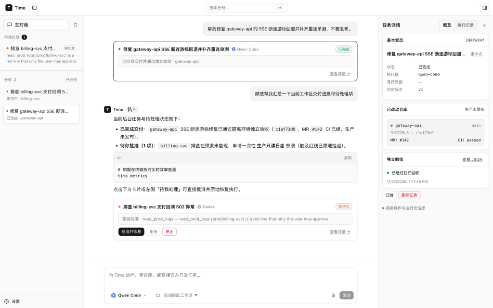
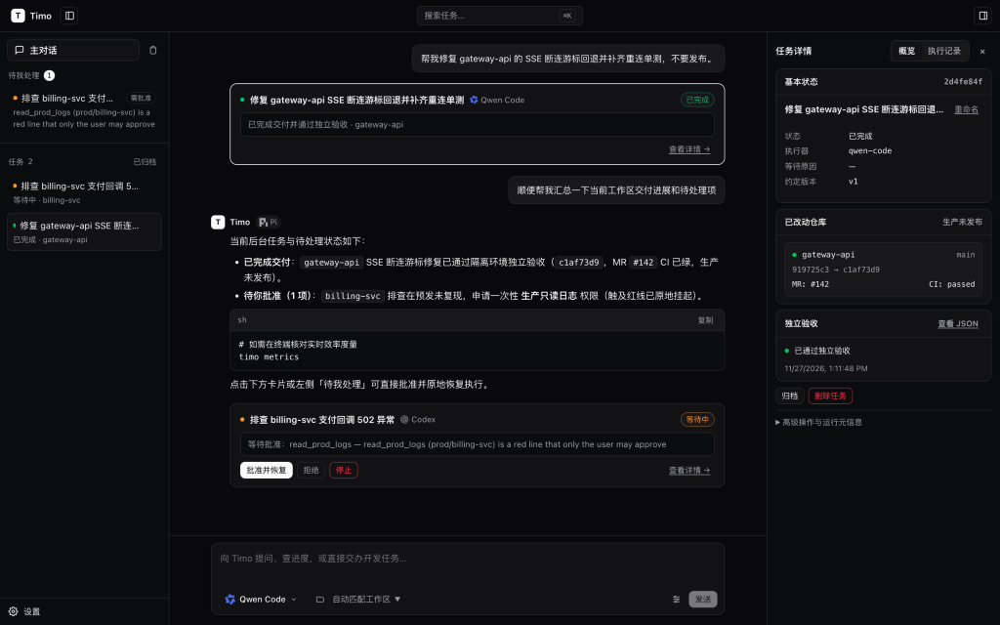

<p align="center">
  
</p>

<h1 align="center">Timo</h1>

<p align="center">
  <a href="https://github.com/chiga0/timo/actions/workflows/ci.yml"></a>
  = 24" />
  <a href="LICENSE"></a>
</p>

<p align="center">
  <a href="README.md">中文</a> · <strong>English</strong>
</p>

> **Local-first Personal Engineering & Ops Delivery Control Plane**  
> Everything handled for you — except your privacy.

Timo is a local-first **Chief of Staff & asynchronous delivery control plane** running on your own machine. It **never builds a custom Agent Loop or Harness** — instead, it orchestrates mature Coding Agent CLIs you already install and authenticate locally (**Pi**, **Qwen Code**, **Codex**, **OpenCode**, and optional **T3 Code**) through a unified `ExecutionAdapter`, while owning the durable task ledger, fixed Main Chat, autonomous multi-repo Git worktrees, 3-tier authorization & local Capability MCP Gateway, 2-level Watchdog, immutable handoff (`g1 → g2`), and independent verification pipeline.

> *"Timo, investigate the timeout retry bug in `order-api`, fix it with unit tests, and tell me once independent verification passes. Do not deploy to production."*

<p align="center">
  
</p>

<details>
<summary>Dark Theme Preview</summary>
<p align="center">
  
</p>
</details>

---

## Core Capabilities

- **Fixed Main Chat + True SSE Streaming**: One persistent `User <-> Timo` conversation with 0ms optimistic rendering, live token-by-token SSE streaming from native CLIs, and XSS-safe Markdown rendering. Casual Q&A and status inquiries stay in Main Chat without polluting your background task list.
- **Single Live-Updating Task Card**: Asynchronous repository deliveries embed inline in Main Chat as a single compact, live-updating card showing the latest step and direct controls (`Stop`, `Retry`, `Approve / Decline`), with detailed logs, diffs, and collapsible verification output tucked into an on-demand right-hand drawer.
- **Attention Firewall (Actionable-Only Inbox)**: A pinned "Action Needed" (`待我处理`) section surfaces **only** items requiring human intervention (red-line approvals, unrecoverable failures, unknown external effects). Completed deliveries never nag you for manual sign-off.
- **Zero Custom Agent Loop**: Reuses mature local CLIs (`pi`, `qwen-code`, `codex`, `opencode`) via `ExecutionAdapter`, auto-discovers each CLI's configured providers and models, and supports seamless cross-executor handoff (`g1 → g2`) via immutable workspace snapshots.
- **Local-First Security & Credential Isolation**:
  - Binds strictly to a `0600` Unix domain socket (`~/.timo/timo.sock`) and `127.0.0.1` loopback with constant-time 256-bit Session Token authentication;
  - Reuses local Git / SSH / `gh` auth where available; stores enterprise Git/API tokens in an isolated `0600` vault (`~/.timo/credentials.json`) read only by the local Capability MCP Gateway — worker subprocesses have business tokens stripped from their environment;
  - Dynamically prunes MCP `tools/list` per `GrantRevision` and fences stale execution generations (`403 GENERATION_REVOKED`).
- **Autonomous Multi-Repo Worktrees & Independent Verification**: Each task runs inside isolated `git worktree` checkouts under `~/.timo/workspaces/<taskId>/g<gen>/`. Before marking any task `completed`, `VerificationPipeline` checks out the exact candidate `headSha` in a clean detached directory and runs declarative checks independently.

---

## Supported Executors

Timo automatically probes `PATH` on startup. Install and sign in to any one or more of the following CLIs:

| Executor ID | CLI Binary | Token Streaming | Live Steer | Native Resume | Local MCP Gateway |
| --- | --- | :---: | :---: | :---: | :---: |
| `qwen-code` | `qwen` / `qwen-code` | ✅ | ✅ | ✅ | ✅ |
| `pi` | `pi` | ✅ | — | — | Env injection |
| `codex` | `codex` | ✅ | — | ✅ | ✅ |
| `opencode` | `opencode` | ✅ | — | ✅ | Env injection |
| `t3` (optional) | T3 Code MCP | ✅ | — | ✅ | MCP |

---

## Quick Start

### Prerequisites

- **Node.js >= 24** (uses built-in `node:sqlite`, zero native C++ build dependencies)
- **Git** (for autonomous multi-repo `git worktree` isolation)
- At least one authenticated local CLI (`pi`, `qwen`, `codex`, or `opencode`)

### 1. Install & Build

```sh
git clone https://github.com/chiga0/timo.git
cd timo
npm ci
npm run build
```

### 2. Start the Local Daemon & Web Workbench

```sh
# Binds to 127.0.0.1 only; generates a random 256-bit Session Token if TIMO_SESSION_TOKEN is unset
TIMO_HTTP_PORT=8790 npm start
```

Open the tokenized URL printed in your terminal:

```text
web http://127.0.0.1:8790/?token=<session-token>
```

Open **Settings → Workspace** in the bottom-left to register your local code or documentation folders. Press `Ctrl+C` for graceful shutdown.

### 3. CLI Usage

Once `timo serve` is running, CLI commands talk over `~/.timo/timo.sock` (`0600`):

```sh
# Check probed executors
node dist/src/cli.js executors

# Delegate a repository delivery task
node dist/src/cli.js create \
  --request-id req-001 \
  --repo /path/to/your-repo:main \
  --request "Fix timeout retry logic and add unit tests" \
  --executor qwen-code \
  --check "npm test"

# Inspect, steer, hand off, stop, or view efficiency metrics
node dist/src/cli.js list
node dist/src/cli.js get <TASK_ID>
node dist/src/cli.js steer <TASK_ID> --message "Keep changes scoped to src/retry.ts"
node dist/src/cli.js handoff <TASK_ID> --executor pi --reason "Switch executor"
node dist/src/cli.js stop <TASK_ID>
node dist/src/cli.js metrics
```

---

## Environment Variables

See [.env.example](.env.example) for a complete template (all optional):

| Variable | Default | Description |
| --- | --- | --- |
| `TIMO_HOME` | `~/.timo` | Local data directory (SQLite ledger, settings, `0600` credentials vault, worktrees, run logs) |
| `TIMO_HTTP_PORT` | disabled | Loopback TCP port (`127.0.0.1`) serving the Web Workbench & REST/SSE API |
| `TIMO_SESSION_TOKEN` | random 256-bit | Optional fixed loopback token for local development |
| `TIMO_RUN_DEADLINE_MS` | `120000` | Per-run hard wall-clock deadline in milliseconds (e.g. `600000` for large repos) |
| `TIMO_MCP_PORT` | random free port | Loopback port for the local Capability MCP Gateway |

---

## Development & Verification

```sh
npm run typecheck
npm run build
npm test
```

## Documentation & Community

- [Architecture & Runtime](docs/architecture.md) · [Domain Model](docs/domain-model.md) · [Technical Design](docs/technical-design.md)
- [Product PRD & Minimal Prototype](docs/product.html) · [Milestones](docs/milestones.md) · [Acceptance Scenarios](docs/acceptance.md)
- [CONTRIBUTING.md](CONTRIBUTING.md) · [SECURITY.md](SECURITY.md) · [CODE_OF_CONDUCT.md](CODE_OF_CONDUCT.md) · [CHANGELOG.md](CHANGELOG.md)

## License

Released under the [MIT License](LICENSE).
