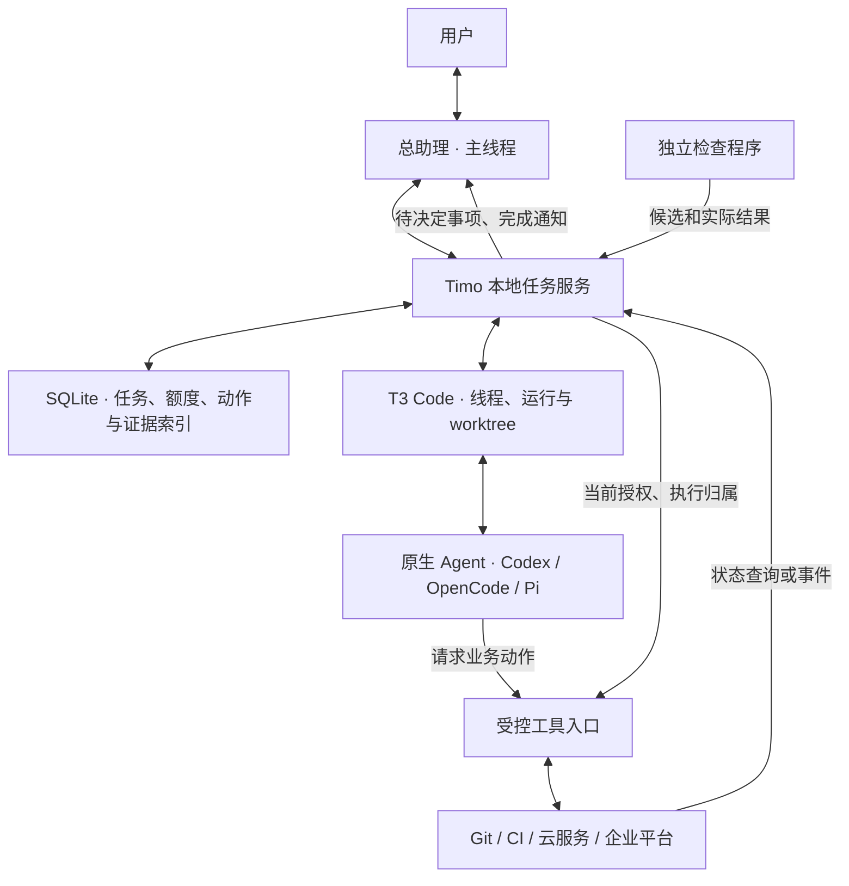

# Timo 架构与运行机制

本文描述首版目标设计。Timo 是独立的单用户产品。总助理负责沟通与协调，Timo 服务负责业务任务、权限与结果，T3 Code 管理线程、运行时和 Git 工作目录。用户可以换对话或执行器，仍能找回一件工作的当前约定、候选和未决动作。

## 系统分工

这些方框表达责任。首版可在一个本地服务中实现任务存储、事件消费、计时与工具入口。拟采用 TypeScript / Node.js 和 SQLite，先复用 T3 界面与原生 CLI。原生 Agent 的模型循环、压缩、原生会话与工具协议由对应运行时实现。需要私网访问或更强身份隔离的工具可以放到单独的执行端，结果以原操作 ID 返回。

| 责任方 | 可以决定或改变什么 | 以什么作为事实 |
| --- | --- | --- |
| 用户与总助理 | 用户确定目标、取舍与授权。总助理发起任务、提出分工、转达用户的改口，汇总需要决策的事项 | 原始请求、后续澄清、已授权范围和用户偏好 |
| Timo 任务服务 | 接纳业务变更，控制预算、写入归属、验收和通知。业务 Task 状态由它独占更新 | 有版本的任务约定、操作记录、独立检查结果、平台回执 |
| T3 与原生 Agent | T3 管线程、Run、Provider 接入和工作目录。执行者推理、操作获准工具、交付候选 | T3 的线程历史与运行观测、原生会话引用、候选文件 |
| 平台与验收执行端 | 平台授权并执行实际操作。验收端观察固定候选、测试环境与外部状态 | 平台上的 MR、CI、部署、日志或业务结果，检查程序生成的原始证据 |

**主对话如何接单。** 首版拟在 T3 中保留一个总助理线程，为它提供 Timo 的建任务、查进度、修改约定和停止入口。总助理把用户原话和本次请求标识传给 Timo，拿到持久的 Task ID 后才回复“已接单”。重复传入同一次请求时返回同一项任务。工作线程只拿到本任务的工具与授权。用户换主对话后，可以按 Task ID 或从自己的未结任务列表找回进度。M0 先验证入口和权限，再确定采用的接口。

## 任务、会话和工作环境

| 对象 | 归属与生命周期 |
| --- | --- |
| **Task** | Timo 的业务承诺，可持续数轮、数天。持久保存原始需求、必须项和禁止项、截止时间、额度与验收条件。随口咨询可直接回答。 |
| **AppThread / Run** | T3 的对话和单次执行。主对话可创建多个 Task，一项 Task 可关联负责人和只读检查线程。Run 结束或线程归档只更新运行观测。 |
| **ProviderThread / ProviderSession** | 原生对话及其运行连接，按服务端和 Provider 实例标识。能否原生续接取决于驱动、身份和运行环境。 |
| **工作资源 / Worktree** | Timo 记录 Task 涉及的仓、云资源和执行位置。T3 管其创建的目录。同一仓可有多个并行任务；每个可写目录同时只有一个已确认的写者。日志排查无需 Git。 |
| **候选与证据** | 一次跨仓候选是一组确定的提交或冻结制品。未提交、未跟踪文件需在受控位置显式保留。证据绑定候选、要求、检查版本与环境。 |
| **外部操作 / 执行尝试** | 为一次明确意图记录稳定的 operation ID、目标与输入。每次实际尝试有各自的 attempt ID。重试和换执行器沿用原意图，费用按每次尝试累计。 |

两个仓的 `main` 可以指向不同时间点。任务要保存解析后的每仓 base SHA、候选摘要、对应 MR/head 与 CI 结果。组合验收针对这组版本；部分成功时继续补查相应仓。worktree 隔离代码目录，共用的数据库、端口、生成目录和远端目标要另外分配或协调。

## 一个任务如何运行

1. **接单。** 总助理将原话和必要澄清写入 Task。先明确必须交付的结果、禁止项、允许的身份和资源、费用与墙钟期限。已授权范围内可直接推进；只有目标冲突、扩大权限或代价取舍才需要问人。
2. **准备与执行。** 按任务解析资源、选择运行位置和工具。Timo 记录执行归属，绑定 T3 实例及线程；默认一个负责人，互不依赖且能分别取证的子任务才委托。模型提出的计划在动作执行前仍需通过实际权限检查。
3. **推进或等待。** 复现问题、排除一个根因、形成候选或取得真实平台结果都算有效进展。相同失败且没有新证据时，保存最佳候选，有限换方法、求助或停止。CI 排队按 job ID 等待，短暂断网按可恢复故障处置。任务可分别显示等待平台、等待人、等待授权或效果待核对。
4. **验收与报告。** 必须项逐条取证，分别给出通过、失败、未知。程序可按认可规则自动接纳；体验、重大取舍或未覆盖条件交给用户。总助理从已接纳事实生成汇报，列出证据和剩余义务。
5. **资源清理。** 确认旧写者和后台活动已结束，保存必要候选及回执；检查未跟踪文件、未交付成果、待审变更和在途作业后，才交由目录所有者回收。

预算覆盖父子 Agent、模型切换、重试、检查和收尾。在原总额内预留取消、取证和交付说明的空间。个人服务可控制自己接纳的调用和时间；对于单轮内部自主调用、事后才报告费用的 CLI，估算和实报分别记录，未知留空，硬上限依赖执行端或供应商配额。

## 身份、网络与外部写入

最小授权记录包含任务、动作、目标资源、环境、有效期及授权来源。要求版本、授权版本与执行代次分别维护，使“只改需求”“撤销发布”“换负责人”能独立生效。角色名、Skill 和账号别名用于选择能力；强制约束发生在平台或受控工具入口。

- **模型身份与业务身份分开。** 原生 CLI 保留其合规登录方式。资源目录保存账号别名和秘密引用。凭据由现有密钥存储、平台或企业 IdP 提供。受限 Worker 使用独立的只读身份或只能调用固定操作的工具，避免同时继承其他可写凭据。
- **凭据在执行位置取得。** 例如同一任务需要读取测试日志并在 GitHub 提 PR。Timo 分别记录允许查询的日志范围和允许写入的仓库。日志工具在有内网路由的位置领取只读凭据；提交工具以指定的 GitHub 身份操作该仓。优先让工具持有短期凭据，Worker 只得到调用能力和结果。平台只支持交互登录时，记录由谁完成登录、有效期以及到期后哪一步暂停。
- **执行前核验。** 对 GitHub、内部 Git、日志、容器诊断、OpenAPI 和部署，实际执行端核对当前授权、执行归属、目标与参数。已有原生登录或 Full access 配置可能令通用 Shell 越过代理；在这类配置中只承诺可信本地运行。需要强限制的场景必须先建立隔离或让目标平台实际拒绝越权。
- **网络和数据各自约束。** 访问内网的执行端需具备相应路由、VPN 或堡垒机能力。受信工具只把获准的脱敏结果返回指定模型。分别报告身份失效、权限不足、网络不可达和服务错误。

**外部写入的恢复顺序**为先保存操作意图，再执行并查询结果。调用有回执就保存平台 ID；响应丢失时沿用原操作身份查询目标。能证明未发生，或下游仍可按原键安全去重，且授权依然有效时才可重试；否则标记效果未知并暂停相关后继。取消要分别核对后续派发、已有进程、凭据与平台已接收的作业。一次本地事务无法证明一个远端写入恰好执行一次。

## 持久化、主动监控与个人知识

业务 SQLite 只保存需要独立解释任务的事实，包括约定和授权版本、Task 与线程绑定、候选、操作及尝试、验证记录、用量和待通知事项。运行日志与完整对话继续通过 T3 读取。必要原文、附件和可移植证据按内容摘要保存在访问受控的制品位置。数据库只存引用不解决上游数据过期，重要证据要在实际保留期内保存。

T3 事件、定时器或平台回调进入本地服务。业务更新、消费进度及待处理通知在同一事务落盘，按事件或操作身份去重。断线后按已知任务和平台对象重新查询当前状态，再生成缺少的业务更新。普通心跳与总助理自身的普通回复不触发新推理。离线时展示最后观测时间；若必须在笔记本休眠期间及时处理，就把监听器放在获准的常在线位置。

资源清单记录仓库、服务、环境、身份引用和关联知识库；版本化 Runbook / Skills 记录怎么开发、排查或发布。经验记录附来源、时间与适用环境，用户可以纠正或废弃。任务执行时保存实际引用版本。历史对话、自动生成的经验和文档检索结果不能扩大权限。

## 跨 Agent 交接与独立验收

同一 AppThread 可关联不同原生会话。T3 提供有界历史交接；历史附件、在途工具调用和原生进程需要单独处理。Timo 准备任务交接材料，包括目标及禁止项、剩余额度、各仓候选、未跟踪文件、已排除的假设、关键证据和未决外部操作。新执行器需具备相应工具及数据访问资格。确认旧写者已停止或旧代次被强制拒写后，再交出可写工作区。旧执行的迟到结果可保留，不能覆盖当前候选或解锁新任务。具体兼容范围见 [T3 集成手册](t3-integration.md)。

验收从冻结制品读取。固定镜像或环境配方、依赖锁、检查版本和测试数据；每次创建独立可写目录和数据空间。候选代码不能修改检查规则或权威结果。若要求“修复断连、提 MR 并等 CI”，只读检查两仓当前版本的重连行为、各自 MR 与 CI，再判定交付。若另有发布授权，还需查部署目标、运行版本和约定后验。可信度或覆盖范围不足时标记未知。具体反例见 [验收剧本](acceptance.md)。
