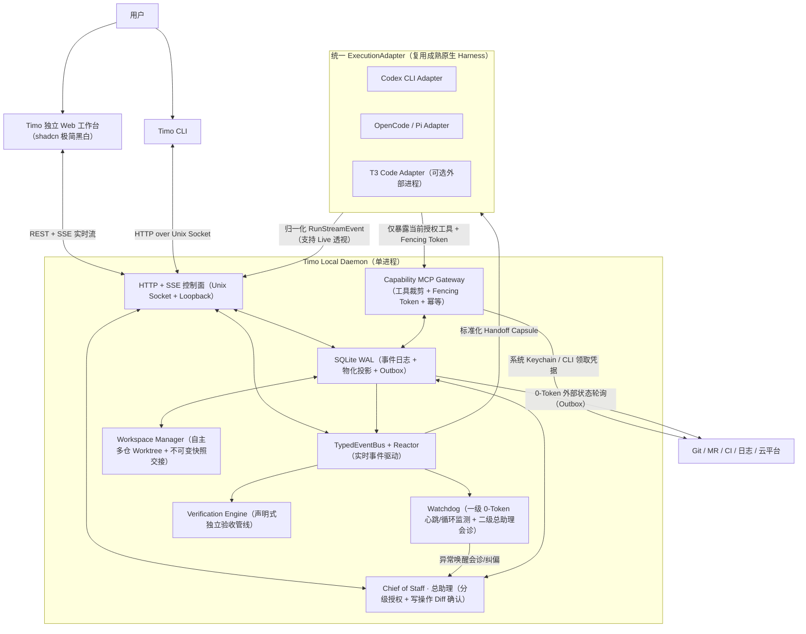

# Timo 架构与运行机制

本文描述 Timo 定案的目标架构。Timo 是一个单用户、本地优先的**个人研发与运维交付控制面（Delivery Control Plane）**。

核心设计原则如下：
- **绝不自研 Agent Loop / Harness**：模型推理循环、上下文压缩、文件编辑工具与原生重试全部直接复用成熟外部执行器（Codex CLI、OpenCode、Pi，以及作为可选外部适配器的 T3 Code）。
- **控制面与执行面解耦**：Timo 自主掌控业务任务账本、总助理分级委派授权、两级 Watchdog 巡检、多仓 Worktree 与不可变交接、受控能力网关（Capability MCP Gateway）、独立验收门禁以及独立 Web 控制台。
- **事件驱动 + 持久化账本**：在线态由进程内 `EventBus` 毫秒级事件驱动前端 SSE 与状态机 Reactor；断线、休眠或崩溃后由持久化事件日志与 Outbox 补查兜底，不把内存事件流作为唯一事实来源。

## 系统总览

## 责任边界与系统分工

| 责任方 | 决定或掌控什么 | 以什么作为事实来源 |
| --- | --- | --- |
| **用户** | 制定总助理的常设委派策略（Standing Policy）、红线清单、最终业务取舍与高危审批 | 常设策略、显式批准/拒绝记录、最终合并/发布决策 |
| **总助理（Chief of Staff）** | 自然语言接单、排优、聚合汇报；在 Standing Policy 范围内**自主批复 Worker 的常规权限**；接收 Watchdog 异常警报进行纠偏或换执行器；对高危写操作向用户推送 Diff 确认卡 | 原始请求、Standing Policy、任务当前投影、Watchdog 诊断摘要 |
| **Timo 控制面（Daemon）** | 独占推进业务 Task 状态、持久化事件账本、执行代次与 Fencing Token、多仓 Worktree 生命周期、能力网关门禁、0-Token 外部轮询与独立验收 | 追加式 `task_events`、物化投影、操作意图与回执、冻结制品与验收证据 |
| **外部执行器（Codex / OpenCode / Pi / T3）** | 负责 Agent Loop、模型推理、上下文压缩、代码分析与修改、提交候选；向 Timo 回传归一化实时执行流 | 原生会话引用、实时运行流日志、候选文件或提交 |
| **外部平台与验收端** | 实际执行 MR/CI/日志/云操作；在独立干净环境中验证冻结候选 | 平台上的 MR ID、精确 head SHA、CI 状态、独立验证器原始输出 |

## 唯一主入口与双通道控制面

首版正式确立**独立 Timo 本地 Web 工作台**为主交互面（详见 [产品设计与极简原型](product.html)），CLI 共用同一套 HTTP 控制面 API。外部执行器不再承载 Timo 的主对话界面。

为兼顾自然语言的便捷性与工程操作的零幻觉，控制面严格区分两条通道：
1. **确定性操作通道（0 LLM、0 Token）**：审批按钮（批准/拒绝）、停止任务、撤销授权、平台对账、展开原文证据、查看实时运行流与人工纠偏注入——全部由 UI/CLI 直接调用控制面 REST API 写入事件，不经过大模型。
2. **对话式总助理通道（复用轻量现成 Runtime + 受控工具）**：
   - **只读查询直接答**：查进度、查待决事项、跨任务汇总；
   - **普通建单直接落盘**：在 Standing Policy 范围内创建新 Task 并返回任务卡；
   - **高危变更两阶段确认（Propose → Commit）**：凡涉及需求改口、扩大红线权限、撤销授权或停止任务的自然语言指令，总助理先生成一张带明确 `Task ID` 和前后对比的 **Amendment Diff 确认卡**，防止多任务并发时指代串台，由用户点击确认后生效。

## 注意力防火墙（Attention Firewall）

为防止收件箱退化为堆满子步骤日志的不可读信息流，架构层面强制执行 4 条硬约束：

1. **写入通道物理隔离**：Worker 与后台调度器无权向“主对话”或“待你决定（Inbox）”写消息。所有过程遥测（读文件、跑命令、重试、CI 排队、总助理自动批复的常规权限）仅写入右侧检查器（Inspector）的概览与「实时运行流」。
2. **严格 3 枚举事件穿透**：只有 `DECISION_REQUIRED`（触及红线或必须人做选择）、`DELIVERY_VERIFIED`（独立验收通过，产出最终交付结论）和 `TASK_BLOCKED_FINAL`（预算耗尽、连续同错或外部效果未知，系统无法自行收敛）允许进入主对话与待决收件箱。
3. **单任务单卡 Upsert + 禁止子任务冒泡**：Inbox 按 `(taskId, decisionKey)` 原地更新，不重复追加；跨多仓、多子步骤的进展永远聚合在父 Task 下。
4. **默认静音，一键透视（Progressive Disclosure）**：主对话保持不可变事件时间线，顶部吸顶条展示活跃任务实时状态；想看某个 Worker 的真实执行过程时，在右侧检查器切到**「实时运行流（Live）」**即可实时查看工具调用、终端输出与代码 Diff，并支持直接注入纠偏指令。

## 三层分级委派授权与能力网关

为了既保安全、又不让权限校验演变成“简单任务来回报错十几次”的效率灾难，采用**分级委派 + 工具裁剪 + 原地挂起**机制：

1. **三层授权体系（Standing Policy → Chief of Staff → Worker）**
   - **Tier 0（默认静默放行）**：worktree 内读写、本地单测与构建、已注册预发日志只读、CI 状态查询。
   - **Tier 1（总助理自主批复范围）**：用户在 Standing Policy 中预授给总助理的范围（如给指定开发仓提交 PR、在任务预算内补充开发/预发只读权限）。Worker 缺权时上报总助理，总助理校验策略后**直接签发新 `GrantRevision` 并原地恢复 Worker**，记入审计流，不打扰人。
   - **Tier 2（永久红线，必须请示用户）**：生产写操作与发布、合并主干分支、生产敏感数据/全量日志访问、删除云资源、跨未注册仓库或超预算上限。
2. **工具可见性裁剪（Tool Visibility Pruning）**：Capability MCP Gateway 在 `tools/list` 时**只暴露当前 `GrantRevision` 允许的工具**。如果任务禁止发布，Worker 连发布工具的 schema 都看不见，从源头杜绝误调报错和空烧 Token。
3. **缺权原地挂起（Pause & Resume）**：执行中途确需提权时，任务进入 `Waiting` 并完整保留当前 worktree 与上下文，获批后原地续跑，不判失败也不重头返工。
4. **凭据隔离与 Fencing Token**：真实平台凭据由本地网关进程从系统 Keychain / 企业 CLI 领取，不暴露给 Worker 环境变量。每个 Worker 拿到的本地 MCP Endpoint 绑定 `(taskId, generation, nonce)`；一旦停止或换执行器，旧代次 Token 毫秒级作废，网关直接拒绝旧写者的任何外部写调用。

## 两级 Watchdog（看门狗）与异常自愈

解决“任务跑了一小时没动静，不知道是卡死、断网还是走偏”的问题：

1. **一级：确定性 0-Token 看门狗（纯代码定时巡检）**
   - **活性心跳（Stall）**：监测执行器进程存活与事件流静默时长（如超过 3–5 分钟无输出）。
   - **死循环检测（Loop）**：监测连续重复相同失败指纹或反复修改同一文件无进展。
   - **进展超时（Soft Deadline）**：达到软期限仍未产出有效 Diff、候选或外部回执。
   - **范围漂移预警（Scope Drift）**：修改的文件路径或文件数量显著超出任务约定。
2. **二级：总助理按需会诊与纠偏（仅异常触发）**
   - Watchdog 发出异常信号后，将压缩的近期活动摘要交给总助理判断：进程/网络中断则自动重连补查；死循环或走偏则向 Worker 注入纠偏指令（Steer）或触发换执行器接手；确认属于需求歧义或外部阻塞时，再向用户发出结构化求助卡。

## 自主多仓 Worktree 与不可变交接

借鉴 T3 Code 的统一运行时抽象与 Portable Handoff 思想，但由 Timo 自主掌控工作区与交接确定性：

- **自主 `WorkspaceManager`**：直接通过原生 `git worktree` 在 `~/.timo/workspaces/<taskId>/g<generation>/<repo>` 管理零个、一个或多个仓库。逐仓锁定并核对真实 `baseSha`，禁止缺分支时的静默 fallback；显式隔离仓外文件，防止跨任务污染。
- **不可变目录交接（Immutable Workspace Handoff）**：在 Codex / OpenCode / Pi 之间切换执行器时，不依赖脆弱的“证明旧进程树完全死亡”来复用同一可变目录。标准交接顺序为：
  1. 向旧执行器发出中断请求；
  2. **立即作废旧代次 `g1` 的网关 Fencing Token**；
  3. 冻结 `g1` 当前 `git diff` 与未跟踪文件清单，构建新的 **`g2` 独立 worktree 目录**；
  4. 生成协议无关的 **Handoff Capsule**（当前 Brief/Grant、各仓 Diff 摘要、已验证事实、失败假设、已有外部操作 ID、剩余预算）；
  5. 同 Provider 优先原生 Resume，跨 Provider 由新执行器在 `g2` 读取胶囊接续工作。
  即使旧进程残留并在 `g1` 继续写入，既污染不到 `g2`，也无法通过网关操作任何外部平台。

## 外部写入对账、事件驱动与独立验收

- **外部写入顺序（Intent-Before-Effect）**：先在 SQLite 持久化操作意图与稳定幂等键，再调用平台，收到回执即落盘。响应丢失时进入 `effect_unknown`，禁止自动盲重发，必须先按原操作 ID 查询平台真实状态；无法确认则停留未知态交由人核查。
- **0-Token 外部等待**：CI 排队、MR 状态变化由后台 Outbox 定时插件按退避策略轮询（或接收 Webhook），不消耗大模型 Token；状态跃迁后转成内部标准 Event 注入 `EventBus` 驱动后续验收或汇报。
- **声明式独立验收（Verification Pipeline）**：候选提交后，验证器在独立只读/隔离环境中按任务挂载的检查步骤（`command_check` 真实单测/联调、`platform_mr` 精确 head SHA 与 CI 核对、`log_citation` 原文行号校验、`human_signoff` 人工签字项）逐条取证。任一仓库新提交均使旧组合证据自动失效；只有所有必须项通过且与当前约定版本匹配，Timo 才将任务置为 `completed`。具体验收剧本见 [首版验收剧本](acceptance.md)。
