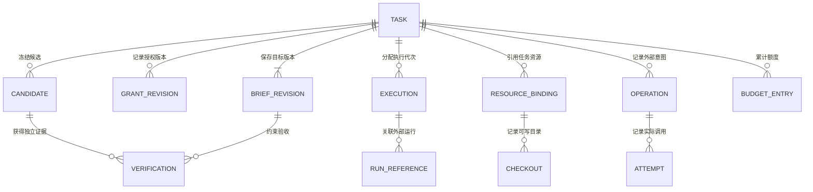
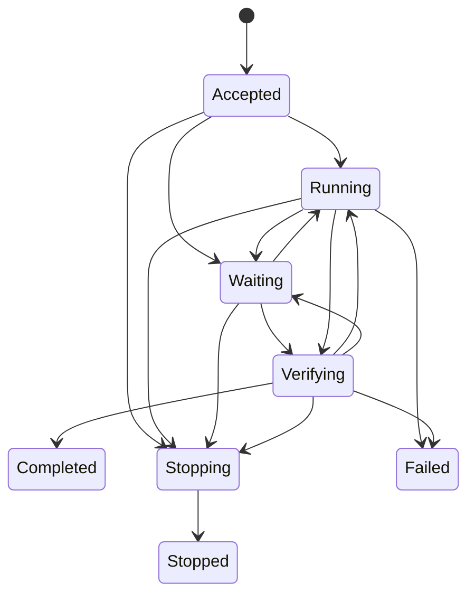

# 业务概念与模型

Timo 的业务单位是 **Task**。用户在总助理对话里交办工作，Timo 持久保存约定、执行进度和验收结论。一段对话可以引出多项 Task，一项 Task 可以跨越多轮执行、更换执行器、等待外部系统。知识问答和进度查询可以直接处理。

## 概念模型

| 概念 | 含义与归属 |
| --- | --- |
| **总助理** | 用户入口和汇报者。Timo 接收其提交的用户意图。修改目标、授予权限及撤权都保留来源和版本。 |
| **Task / BriefRevision** | Task 是可回查的交付承诺。每版约定含原请求引用、必须项、禁止项、证据标准、期限和预算。当前约定用于判定当前结果。 |
| **GrantRevision** | 授权记录包含来源、动作、资源及环境、身份引用、有效期。需求修改、撤权和执行权移交分别生效。 |
| **Execution / RunReference** | Execution 是 Timo 分配的一次执行代次，关联指定 T3 环境和线程。RunReference 保存具体 run、实际 Provider 和最后观测。重试可增加 RunReference，换负责人由新的 Execution 接管。 |
| **ResourceBinding / Checkout** | 任务可引用零个或多个仓库、服务、日志源或知识版本。Checkout 记录原仓、base SHA、实际路径与写者归属。同一个原仓可供多个任务各自创建工作目录。 |
| **Operation / Attempt** | Operation 记录一次外部动作的意图和稳定标识。Attempt 记录实际调用，包含目标、授权代次和已收到的回执。同一次意图可以有多个尝试。 |
| **Candidate / Verification** | Candidate 是日志结果、冻结文件或一组仓库提交。Verification 绑定候选摘要、约定版本、验证器与环境版本，并保存实际观察。最终结论引用覆盖必需项的证据。 |
| **BudgetEntry** | 记录额度预留、实报用量与未知项。重试、接力和子任务沿用原 Task 总额。 |

T3 持有线程、运行、原生会话和由它创建的工作目录。Timo 保存带环境标识的引用，以及业务决策、候选和独立证据。以上为业务概念，表结构按 [技术设计](technical-design.md) 分阶段落地。

## 状态与等待原因

**Waiting** 记录等待原因、恢复条件、最后观测时间与下一次核对时间，涵盖等待人、权限、平台、工作区和外部效果补查。**Stopping** 表示停止已生效于新派发，原运行及外部效果正在核实。**Completed** 由 Timo 根据当前约定与验收证据写入。无法满足约定时保存失败结果。终态保留历史，后续新要求另立任务并引用原任务。

以 SSE 排查为例，识别日志断连可以独立交付。用户在任务执行中追加前后端修复时，Timo 更新约定和授权，为两个仓库各建工作目录。候选由两仓提交组合构成，MR 与 CI 各自关联实际 head。即使两条 CI 都绿，组合重连失败也会产生失败的 Verification，任务继续修复或交付失败记录。对应剧本见 [首版验收](acceptance.md)。
