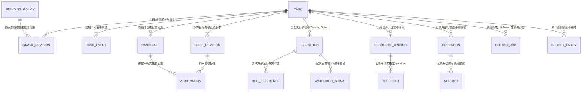
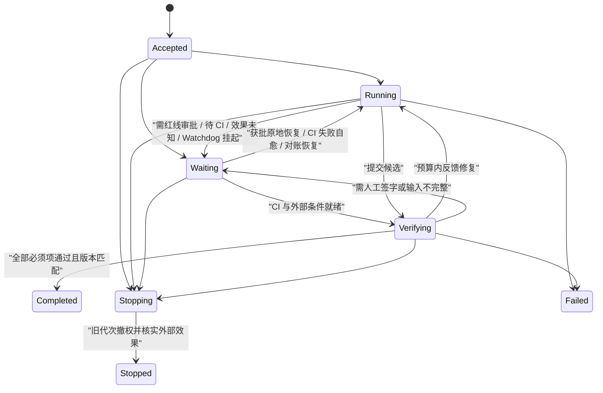

# 业务概念与领域模型

Timo 的核心业务单位是 **Task**。用户在主对话或 CLI 交办工作，Timo 通过**追加式事件日志（Event Log）+ 物化当前视图（Projection）**持久保存约定、分层授权、执行代次、外部操作回执、Watchdog 信号与独立验收证据。

一段对话可以关联多项 Task，一项 Task 可以跨越零个或多个仓库、多轮执行、中途切换不同原生执行器（Codex / OpenCode / Pi / T3）以及数天的外部异步等待。

## 概念关系模型

## 核心概念定义

| 概念 | 含义与归属 |
| --- | --- |
| **StandingPolicy** | 用户配置给总助理的常设委派策略，明确划分 Tier 0（默认放行）、Tier 1（总助理可自主批复）与 Tier 2（永久红线，必须请示用户）。 |
| **Task / TaskEvent** | `TaskEvent` 是追加式不可变事实源（带单调 `seq` 与幂等键），记录接单、改口、授权、换代、Watchdog 信号、外部意图/回执、验证结论与人工决定；`Task` 是同事务维护的当前物化视图，同时支撑前端 SSE 按 `afterSeq` 断点续传。 |
| **BriefRevision** | 任务约定版本。保存原始请求引用、必须交付项、禁止项（如禁止生产发布）、验收管线配置、软/硬期限与总额度。需求改口递增版本号，旧历史完整保留。 |
| **GrantRevision** | 授权版本。包含批复来源（`user` 或 `chief_of_staff`）、允许动作、目标资源/环境、身份引用与有效期。需求修改、撤权和执行代次切换独立生效，不混用版本号。 |
| **Execution / RunReference** | `Execution` 是 Timo 分配的一次执行代次（`g1`, `g2`...），绑定具体执行器、独立 worktree 路径、交接胶囊摘要与**专属 `fencingToken`**。切换执行器或停止任务时立即作废旧 `fencingToken`。`RunReference` 记录单次运行的外部 ID、状态及独立落盘的实时执行流路径（`liveTranscriptPath`）。 |
| **WatchdogSignal** | 一级 0-Token 看门狗产出的确定性异常信号（`stall` 心跳停滞、`loop` 重复同错、`soft_deadline` 超时无进展、`scope_drift` 改动范围漂移），用于唤醒二级总助理介入纠偏或换执行器。 |
| **ResourceBinding / Checkout** | 任务关联的零个或多个仓库、日志源、服务或 Runbook 版本。`Checkout` 记录每仓锁定的 `baseRef`/`baseSha`、当前代次的独立 worktree 路径及快照基线。 |
| **Operation / Attempt** | `Operation` 记录一次外部写入的稳定意图与幂等键（`clientRequestId` / `operationKey`）；`Attempt` 记录实际调用尝试、使用的授权版本、代次与回执。响应丢失时记录为 `effect_unknown`，禁止自动盲重发。 |
| **Candidate / Verification** | `Candidate` 是一组冻结制品（日志结论 JSON 或多仓 `{repo: sha}` 组合摘要）。`Verification` 按声明式步骤（`command_check` / `platform_mr` / `log_citation` / `human_signoff`）独立产出 `pass / fail / unknown`。任一仓库出现新提交时，旧组合证据自动标记为 `stale`。 |
| **OutboxJob** | 持久化异步作业队列，承载非阻塞任务派发、0-Token 外部 CI/MR 轮询、Watchdog 定时检查与重启补查，支持 `run_after` 退避与并发池认领。 |
| **BudgetEntry** | 累计全树费用与墙钟时间（涵盖多轮修复、换执行器、Watchdog 会诊与验收）。实报与估算分开记录，缺失记未知不填零；换执行器或重试绝不重置额度。 |

## 任务状态与等待语义

- **Waiting** 必须携带明确的 `waitingReason`、恢复条件、最后核验时间及下次核对时间：
  - `needs_human_decision`（触及红线权限、需求歧义或高危变更 Diff 待确认）
  - `needs_cos_triage`（Watchdog 触发异常，等待总助理会诊纠偏）
  - `waiting_external_ci`（0-Token 轮询外部 CI / 平台作业）
  - `effect_unknown`（外部写回执丢失，禁止盲重发，待按原操作 ID 核查）
  - `runtime_unavailable` / `auth_expired`（执行器不可达或凭据过期）
  - `input_incomplete`（输入缺失或格式不完整）
- **暂停与原地恢复（Pause & Resume）**：执行中若因缺权或需要确认而进入 `Waiting`，系统完整保留当前 worktree 与执行上下文；获批后原地恢复，不将任务判失败，也不丢弃已有成果。
- **Completed** 只能由 Timo 在核对当前 `BriefRevision` 对应全部必须验收项均通过后写入；任何执行器的 `run completed` 或单仓 CI 绿灯都不能单独宣告业务完成。终态保留完整历史，新需求另立任务并引用原任务。
