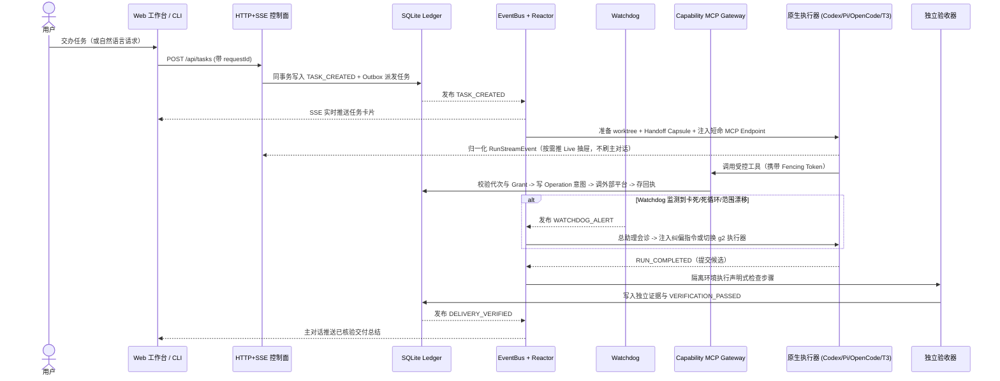

# Timo 技术设计与选型

## 1. 技术选型基线

遵循**“单进程轻底座、零自研 Agent Loop、事件驱动 + 持久化账本、极简黑白前端”**原则：

| 层 | 采用方案 | 选型依据与落地要求 |
| --- | --- | --- |
| **运行时与语言** | TypeScript 严格模式、ESM、Node.js 24、npm、tsc | 单仓库起步，锁定依赖与 `package-lock.json`；复用已核对的 Node 24.15.0 原生 `node:sqlite` 与 `node:test`。 |
| **持久化账本** | SQLite（`node:sqlite`），WAL + 外键 + `BEGIN IMMEDIATE` | 单服务进程独占写入，事务短小且**网络调用期间绝不持有事务**。从当前 M1 表结构平滑演进为 **Event Log (`task_events`) + 物化投影 + `outbox_jobs` + 内容寻址制品索引**。 |
| **本地控制面与实时推送** | Node 内置 `node:http`（或轻量 Hono）同时暴露 **Unix Socket + Loopback HTTP/SSE** | Unix Socket（`~/.timo/timo.sock`，`0600`）供 CLI 与高信任本地工具免密调用；`127.0.0.1:<port>`（启动生成随机 Session Token）供 Web 控制台提供 REST API 与 **SSE `/api/events?afterSeq=N`** 增量实时推送。CLI 与 Web 共用同一套应用层与 HTTP 契约。 |
| **事件驱动内核** | 进程内 `TypedEventBus` + 持久化 `task_events` + `outbox_jobs` | 在线态事件落盘即触发 EventBus，毫秒级驱动前端 SSE、Watchdog 与状态机 Reactor；离线/休眠/崩溃/无公网回调场景由 `outbox_jobs` 按 `run_after` 退避补查，再转标准内部 Event 驱动状态机。 |
| **独立 Web 工作台** | React 19 + Vite + Tailwind CSS v4 + shadcn/ui（Zinc 极简黑白） | 静态构建产物由 `timo serve` 内嵌托管；95% 黑白灰 + 5% 极微语义点，提供三栏可折叠布局、固定底部输入框、吸顶活跃条、Diff 确认卡、实时运行流下钻与 `⌘K` 命令面板。视觉与交互规范见 [product.html](product.html)。 |
| **执行器接入层** | 统一 `ExecutionAdapter` 接口 + 归一化 `RunStreamEvent` | **绝不自研 Agent Loop / Harness**。保留已实测通过的 `T3Adapter`（`@modelcontextprotocol/sdk` Streamable HTTP），并参考 T3 的统一会话抽象补齐极薄的原生 CLI 直连适配器（`CodexAdapter`、`OpenCodeAdapter`、`PiAdapter`，各约 150–250 行）。 |
| **工作区管理** | Timo 自主 `WorkspaceManager`（原生 `git worktree`） | 管理零仓/单仓/多仓目录（`~/.timo/workspaces/<taskId>/g<gen>/<repo>`）；逐仓校验精确 `baseSha`（禁止静默 fallback）；换执行器时采用 **`g1 → g2` 不可变目录快照交接**，物理隔绝旧进程双写风险。 |
| **能力与权限网关** | 内置本地 **Capability MCP Gateway**（基于 `@modelcontextprotocol/sdk`） | 为每个执行代次签发短命 Endpoint（`/mcp/<taskId>/<gen>/<nonce>`）。按当前 `GrantRevision` **动态裁剪 `tools/list`**（无权工具对模型不可见）；强制校验 `Fencing Token`；外部写操作严格执行 `Intent-Before-Effect` 幂等落盘；真实凭据由网关从系统 Keychain / 企业 CLI 领取，不暴露给 Worker。 |
| **验收引擎** | 声明式 `VerificationPipeline`（插件化 `VerifierRegistry`） | 将具体场景验证器（如 `sse-v1`）从核心服务与表结构解耦，支持组合 `command_check`、`platform_mr`、`log_citation` 与 `human_signoff`。 |
| **测试体系** | `node:test`、临时 SQLite、可控时钟、替换传输/假 CLI | 夹具稳定复现崩溃、丢 ACK、旧代次越权、死循环与错误候选；固定真实环境验证纵向实机交付。 |

## 2. 核心模块边界

| 模块 | 职责与接口边界 |
| --- | --- |
| **控制面入口（HTTP/SSE + CLI）** | 校验参数与 Session Token，解析 `requestId` 去重与乐观并发版本号（`expectedBriefVersion` / `expectedGrantVersion`），统一映射错误码与退出码。 |
| **事件账本与投影（Ledger）** | 原子写入 `task_events`、同步更新物化投影与 `outbox_jobs`，事务提交后广播至 `TypedEventBus`。 |
| **总助理与策略引擎（Chief of Staff + Policy）** | 加载用户 `StandingPolicy`：判定 Worker 提权请求是由总助理自动签发 `GrantRevision` 还是升级为人审批卡；处理自然语言查询与高危变更 Diff 提案；响应 Watchdog 异常警报执行纠偏或换执行器。 |
| **非阻塞调度与 Watchdog（Scheduler + Watchdog）** | 基于 `outbox_jobs` 的有界并发池（不串行阻塞多任务）推进派发、恢复、0-Token 外部 CI 轮询与重启补查；一级 0-Token Watchdog 持续检测进程活性、静默超时、重复失败指纹与文件范围漂移。 |
| **执行器适配层（Adapters）** | 暴露极窄接口：`spawn / resume / steer / interrupt / observe`，并将各执行器原始输出归一化为 `RunStreamEvent` 写入独立运行流日志并推送给 Live SSE。 |
| **工作区与能力网关（Workspace + MCP Gateway）** | 管多仓 worktree 创建、快照交接与清理；管 MCP 工具可见性裁剪、Fencing Token 校验、外部平台调用幂等与脱敏。 |
| **独立验收引擎（Verifier）** | 从冻结制品或隔离 worktree 读取候选，按声明式步骤独立计算证据并回写验证结论；任一仓新提交自动令旧组合证据失效。 |

## 3. 事件驱动与异步调度时序

## 4. 关键工程契约

### 4.1 实时运行流与主账本分离
- 执行器实时产生的细粒度流（Thinking 摘要、工具调用参数与输出、终端 stdout/stderr、文件 Patch Diff）写入独立只读文件 `~/.timo/runs/<taskId>/<runId>.ndjson`，并通过 `GET /api/tasks/:id/runs/:runId/stream` 实时流式推送给前端「实时运行流」Tab。
- 这些高频过程流**绝不写入 `task_events` 业务主表**，也不穿透注意力防火墙进入主对话，既保障数据库轻量，又满足随时下钻透视和人工纠偏。

### 4.2 声明式验收管线解耦
业务任务不再硬编码 `sse-v1`。每项任务通过 `kind` 与 `verificationPlan` 声明验收步骤：
- `log_citation`：如现有 `sse-v1`，从冻结日志重算断连与行号事实；
- `command_check`：在干净隔离的 worktree/环境中执行指定命令（如 `npm run typecheck && npm test` 或联调脚本），记录退出码与原始摘要；
- `platform_mr`：按保存的平台 MR ID 校验目标分支、精确 `head SHA == 候选 SHA` 及所需 CI 列表全绿；
- `human_signoff`：针对体验或重大业务取舍，显式进入 `Waiting(needs_human_decision)` 等待人签字。

### 4.3 凭据、隐私与文件权限
- `~/.timo` 目录权限 `0700`，SQLite、Unix Socket、锁文件与制品文件权限 `0600`。
- 制品目录 `~/.timo/blobs/` 严格按原始 `Uint8Array` 二进制读写，绝不经过字符串编码往返。
- 业务凭据不落 SQLite、不进日志、不进命令行参数；仅由 Capability MCP Gateway 在执行瞬间从系统 Keychain、环境变量或受控企业 CLI 读取。

## 5. 当前底座技术债清单（Sprint 1 优先修复）

基于对现有 M1.1–M1.3 实现（`src/`）的代码审计，升级至事件驱动控制面前需优先修复以下 5 项已定位缺陷：

1. **二进制制品编码损坏**：[artifacts.ts](../src/store/artifacts.ts) 将字节按 `binary` 转字符串后交给 [home.ts](../src/home.ts) 以 UTF-8 写盘，会导致含非 ASCII/中文字符的冻结输入字节损坏、摘要失配；改为直接写入原始 `Uint8Array`。
2. **重启与超时后的 `reconcile` 断链**：[runner.ts](../src/service/runner.ts) 在派发拿到 `runId` 后即将 `operation` 标为 `done`，导致进程被杀或超时进入 `effect_unknown` 后，重启不再捞出在途任务，且 `reconcile()` 目前仅打日志未完成补查与验收闭环。
3. **调度循环串行阻塞**：[runner.ts](../src/service/runner.ts) 在 `for` 循环中同步 `await` 最长 120s 的单任务等待，导致多任务并发时后序任务被饿死；改为基于 Outbox 的非阻塞并发池。
4. **单实例锁竞态与强杀残留 `.sock`**：[ipc.ts](../src/ipc.ts) 使用非原子 `existsSync + writeFileSync`，且旧进程被 `SIGKILL` 留下 `.lock` 和 `.sock` 时重启会报 `EADDRINUSE`；升级为 `node:http` 控制面时改为 `O_CREAT | O_EXCL` 原子锁并先校验旧 PID 清理残留 socket。
5. **通知去重丢失与执行元信息未回写**：[migrations.ts](../src/store/migrations.ts) 的 `notifications` 使用 `UNIQUE(task_id, kind)` 会静默丢弃同一任务的第二次同类等待通知；[task-service.ts](../src/service/task-service.ts) 创建 `executions` 写入的 `providerInstanceId/model = "pending"` 在派发后未回写实际值。升级事件账本时一并根除。
