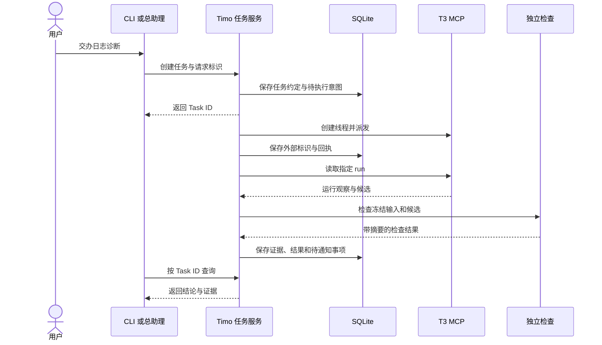

# Timo 技术设计与选型

## 实现基线

| 层 | 采用方案 | 落地要求 |
| --- | --- | --- |
| 语言与构建 | TypeScript 严格模式、ESM、Node.js 24、npm、tsc | 单包起步，提交锁文件，使用 npm ci 可重复安装。M0 机器已核对 Node 24.15.0 与内置 SQLite 3.51.3。 |
| 任务存储 | SQLite、Node 内置 node:sqlite、版本化 SQL 迁移 | 开启外键和 WAL。单服务进程写库，事务保持短小。初次实现验证迁移、异常退出与重启恢复。 [Node.js SQLite 文档](https://nodejs.org/docs/latest-v24.x/api/sqlite.html) |
| T3 接入 | 官方 TypeScript MCP SDK 的 Streamable HTTP 客户端 | SDK 与 OAuth 仅由接入模块使用。M1 首个切片锁 SDK 版本，以 M0 探针对照验证工具发现、登录重连及超时。 [MCP TypeScript SDK](https://github.com/modelcontextprotocol/typescript-sdk) |
| 本地入口 | Node 内置 HTTP，通过用户私有目录内的 Unix socket 提供命令接口 | macOS 和 Linux 为首版目标。CLI 及将来的总助理入口调用同一个应用层。目录权限 0700，socket 权限 0600，同一用户会话启动任务服务。需要独立网络 API 时再确定 HTTP 框架。 |
| 测试 | node:test、临时 SQLite、可控时钟与替换传输 | 固定夹具做掉线和崩溃测试，固定版 T3 验证真实链路。M0 的 Python 探针继续作为运行版本核对工具。 |

T3 固定为 v0.1.12，使用核验后的独立发行进程。Timo 与 T3 各管数据和进程生命周期。M1 先交付 Timo CLI，用户可在 T3 中查看执行线程。若验证总助理能以可信身份调用本地命令，再提供创建、查看、修改、停止四项业务动作的入口。M1 记录两种入口各自的验收结果。 [T3 接入合同](t3-adoption.md) · [M0 证据](t3-integration.md)

## 模块与存储职责

| 模块 | 接口与职责 |
| --- | --- |
| 入口 | 解析命令、校验输入、生成或传递请求标识。返回任务 ID、状态、最后观察和证据引用。CLI 的退出与任务生命周期独立。 |
| 任务应用层 | 创建、修改、停止、查询，执行状态规则和授权校验。SQLite 事务内推进业务状态，并把待派发动作落盘。 |
| 后台推进 | 认领待执行动作、调用适配器、等待外部状态、安排有界重试和通知。进程启动时补查未终结活动。 |
| T3 适配器 | 能力探测、准备空线程、提交、读取、等待、停止。校验响应形状，向业务层返回稳定的运行引用及明确的错误类型。 [方法映射](t3-adoption.md) |
| 验收 | 读取冻结输入和候选，并按当前任务约定运行检查。通过应用层写入证据及结论。 |
| 凭据与制品 | 业务库存凭据引用，秘密由系统凭据存储提供。源日志、必要证据和候选制品经受控目录保存，索引记录内容摘要。 |

M1 首批表覆盖任务及约定版本、授权快照、执行及外部运行引用、待办操作及尝试、候选与验证、额度与待通知事项。名称和列以实现迁移为准。后续引入多仓工作目录约束、平台回执对账和组合候选。T3 完整会话通过外部引用读取。

任务创建请求使用客户端请求标识去重。相同标识和内容返回原任务，内容冲突返回冲突。修改和停止附带当前约定版本或任务版本，防止迟到命令覆盖用户的新决定。业务事务写入状态、待执行意图或通知。提交后再调用 T3 或平台。网络调用期间不持有数据库事务。

## 派发、重启与取消

每次派发持久记录请求 ID、输入摘要、执行代次、T3 实例与 OAuth 授权代次。服务冷启动后先按已知 threadId、runId 和操作回执补查。工具明确拒绝、运行失败、网络超时、结果未知分别处理。只有原请求的授权仍有效且重放语义成立，才使用原请求键重试。重新授权后的未知效果等待查证。

待办由任务服务认领，状态变更与预留额度同事务提交。一个任务同时只派发一个负责人可写执行。用户停止后立即拒绝新的业务派发，按原 run 请求中断，核对后台写者及已发往平台的动作后结束停止。实例重启或租约到期后的目录接管仍需要确认原写者停止，或由执行端实际拒绝旧代次。

## M1 的证据与权限

第一条真实链以合成 SSE 日志为输入，Timo 冻结文件摘要和规则版本。Agent 输出断连／重连事件的证据行号及诊断结果，验证器读取原输入、核对行号、事件事实和约定的必须项。空证据日志、伪造行号及不匹配摘要作为反例。验收程序和结果由 Timo 控制，候选通过校验后才变成对用户的交付。

受限 T3 环境只接收获准输入，任务提交时核对环境、项目、身份与授权。能访问真实业务服务的凭据在对应平台工具的执行位置取得。共享主机上以同一 OS 用户运行时，仍依赖主机信任和目标平台权限。报告费用时分别列出已报用量、估算或未知，并以应用层轮次、期限和准入预算控制新增工作。 [业务状态](domain-model.md) · [实施路径](milestones.md)
